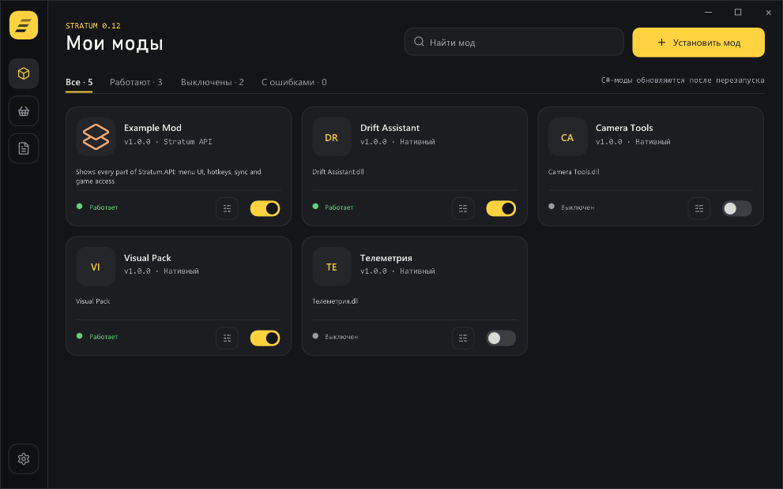

# STRATUM 0.13.0

In-game mod loader for **CarX Drift Racing Online 2** · Windows x64
Мод-лоадер прямо в игре для **CarX Drift Racing Online 2** · Windows x64



## English

### Install

1. Close the game.
2. Copy **winhttp.dll** next to `CarX Drift Racing Online 2.exe` (Steam → right-click the game → Manage → Browse local files). Updating: replace the old file.
3. For C# mods, install the free [Microsoft .NET 8 Runtime (x64)](https://dotnet.microsoft.com/download/dotnet/8.0) once.
4. Start the game through Steam. On the first run the menu opens by itself: pick **English** or **Русский**.

**Insert** opens and closes the menu.

### Mods

Click **Install mod** and choose a mod file, a mod folder, or **Move from BepInEx** (a whole old BepInEx folder). Or put files into `STRATUM\Mods` while the game is closed.

| Supported | Needs |
|---|---|
| Stratum SDK mods (`.strmod` / `.dll`) | .NET 8 |
| BepInEx 6 IL2CPP mods | .NET 8 |
| Native mods (C++ / C# Native AOT) | — |

Turning a C# mod on or off applies after a game restart. BepInEx 5 / Mono mods are not supported.

### What's new in 0.13

- New menu design and the new **Strata** logo.
- Language choice on the first run.
- **Developer console** (Settings): a live log window of STRATUM and all mods.
- Messages from BepInEx mods now appear in **Logs**.

Making mods: get the **Stratum SDK** archive and read `docs/GUIDE-EN.md`.

## Русский

### Установка

1. Закройте игру.
2. Скопируйте **winhttp.dll** рядом с `CarX Drift Racing Online 2.exe` (Steam → ПКМ по игре → Управление → Просмотреть локальные файлы). При обновлении замените старый файл.
3. Для C#-модов один раз установите бесплатный [Microsoft .NET 8 Runtime (x64)](https://dotnet.microsoft.com/download/dotnet/8.0).
4. Запустите игру через Steam. При первом запуске меню откроется само — выберите **Русский** или **English**.


**Insert** открывает и закрывает меню.

### Моды

Нажмите **«Установить мод»** и выберите файл мода, папку мода или **«Перенести из BepInEx»** (целую старую папку BepInEx). Или положите файлы в `STRATUM\Mods` при закрытой игре.

| Поддерживаются | Нужно |
|---|---|
| Моды Stratum SDK (`.strmod` / `.dll`) | .NET 8 |
| Моды BepInEx 6 IL2CPP | .NET 8 |
| Нативные моды (C++ / C# Native AOT) | — |

Включение и выключение C#-мода применяется после перезапуска игры. Моды для BepInEx 5 / Mono не поддерживаются.

### Что нового в 0.13

- Новый дизайн меню и новый логотип **Strata**.
- Выбор языка при первом запуске.
- **Консоль разработчика** (Настройки): окно с живым логом STRATUM и всех модов.
- Сообщения модов BepInEx теперь видны в разделе **Логи**.

Создание модов: архив **Stratum SDK**, руководство — `docs/GUIDE-RU.md`.

```text
<папка игры>\
├── winhttp.dll         ← STRATUM
└── STRATUM\            ← создаётся сама: Mods, Configs, Logs
```
